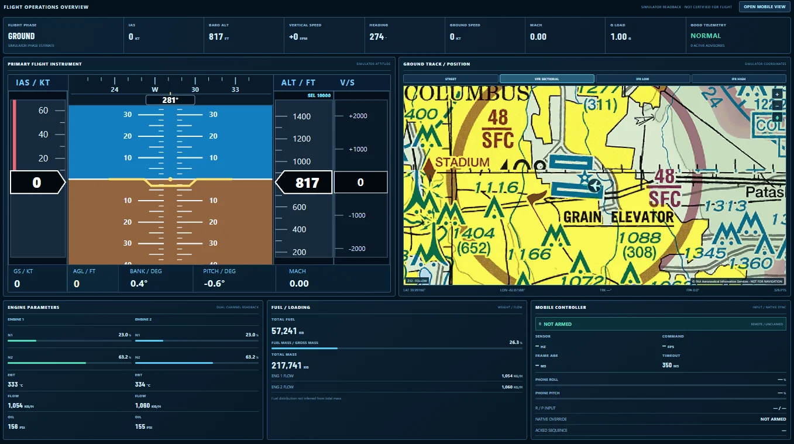
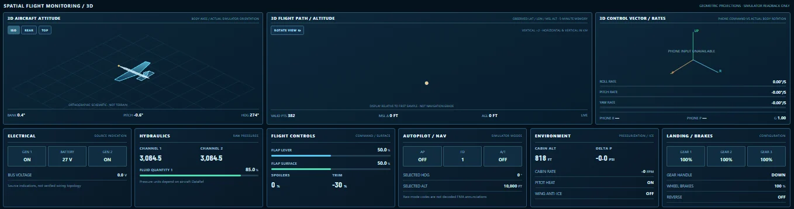
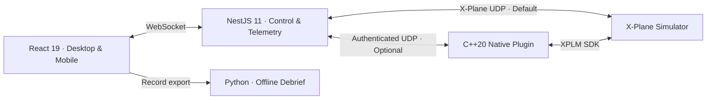

<div align="center">

# XMC FlightOps

### Integrated Flight Control & Operations Monitoring for X-Plane

**A full-stack flight-simulation platform connecting motion-based mobile flight control, a live desktop operations console, and a native C++ integration layer.**

Real-time flight instrumentation · Aircraft systems diagnostics · Telemetry analytics · Flight recording and replay · Offline debrief

<p>
  <a href="https://github.com/hwspen7/xplane-motion-controller/actions/workflows/checks.yml"></a>
  <a href="LICENSE"></a>
  
</p>

<br>

<sub><strong>FLIGHT SIMULATION & NATIVE SYSTEMS</strong></sub>
<p>
  
  
  
  
  
</p>

<sub><strong>DESKTOP, MOBILE & TELEMETRY</strong></sub>
<p>
  
  
  
  
  
</p>

<sub><strong>BACKEND, ANALYTICS & ENGINEERING</strong></sub>
<p>
  
  
  
  
  
  
</p>

</div>
## Flight operations, in one view



*Live flight overview — primary flight instrument, aeronautical position, propulsion and fuel readouts, and mobile-controller health.*



*Spatial monitoring — aircraft attitude, flight path, control vectors, electrical and hydraulic indications, and aircraft systems.*

## Capabilities

| Flight control | Flight observability |
| :--- | :--- |
| **Motion-aware mobile cockpit** with attitude-based input, throttle, flap, gear, and control-state feedback. | **Live desktop overview** with flight instruments, position, engines, fuel, aircraft configuration, and subsystem indicators. |
| **Native C++ control bridge** with authenticated commands, control ownership, input freshness checks, and interruption handling. | **Operations workspace** with subsystem monitoring, flight analytics, telemetry inspection, event correlation, and recording. |
| **Transport selection** between standard X-Plane UDP and an optional native plugin. | **Replay and debrief** with JSON/CSV exports and offline Python-generated PDF or HTML reports. |

### Architecture



**Technology:** C++20 · X-Plane SDK · TypeScript · React 19 · Vite 7 · NestJS 11 · WebSocket · UDP · Python · CMake · pnpm.

## Getting started

**Requirements:** X-Plane, Node.js 24, pnpm 12, and a supported modern desktop browser. The native plugin is optional for the default UDP monitoring path.

```powershell
# Clone and install
git clone https://github.com/hwspen7/xplane-motion-controller.git
cd xplane-motion-controller
pnpm install
Copy-Item .env.example .env

# Build the shared package, web app, and server
pnpm build

# Start the application
pnpm start:server
```

Open **http://127.0.0.1:3000/?view=desktop** for the monitoring console. For development, run `pnpm dev:server` and `pnpm dev:web` in separate terminals.

The default configuration has `XPLANE_OUTPUT_ENABLED=false`. Monitoring can be used without enabling remote flight-control output. Review `.env.example` before configuring control or network access.

### Optional native plugin

The official X-Plane SDK must be downloaded separately. It is **not bundled** with this repository.

```powershell
# Point XPLANE_SDK_DIR to your extracted X-Plane SDK
cmake -S native/xplane-plugin -B build/native -A x64 -DXPLANE_SDK_DIR="C:/path/to/XPlaneSDK"
cmake --build build/native --config Release
```

Install the built `win.xpl` under `X-Plane 12/Resources/plugins/XPlaneMotionController/64/` on Windows. Place a `controller.conf` alongside the `64` directory using `native/xplane-plugin/config/controller.conf.example` as a reference. Set `XPLANE_TRANSPORT=native` and use the same randomly generated secret for `NATIVE_SHARED_TOKEN` and the plugin's `token` setting. Keep network bindings restricted to trusted hosts.

### iPhone controller

Motion-sensor access requires a secure browser context. On a trusted local network, configure HTTPS using:

```powershell
.\scripts\setup-iphone-https.ps1 -LanIp 192.168.1.10
```

Replace the example address with your computer's actual private LAN address, follow the script's certificate-trust instructions, and open the displayed `https://` URL in iPhone Safari. Control output remains disabled until explicitly configured.

### Flight debrief export

Use the recorder's **EXPORT PYTHON JSON** option, then generate an offline report:

```powershell
python -m pip install -r analysis/requirements.txt
python analysis/flight_report.py xplane-flight-record.python.json --output flight-report.pdf --html flight-report.html
```

## Verification

```powershell
pnpm typecheck
pnpm build
pnpm test

# Native core tests (the official SDK is not required for these)
cmake -S native/xplane-plugin -B build/native -A x64
cmake --build build/native --config Release
ctest --test-dir build/native -C Release --output-on-failure
```

GitHub Actions also checks the web/server workspace and native core tests on Windows, Linux, and macOS.

## License & safety

**Copyright © 2026 Spencer Qin.** Licensed under the [PolyForm Noncommercial License 1.0.0](LICENSE). Personal, educational, and other permitted noncommercial uses are subject to its terms. **Commercial use is not generally licensed** and requires separate authorization where applicable. This is a source-available, noncommercial project, not an OSI-approved open-source license.

This software is for **flight simulation only**. Its displays, diagnostics, and flight analysis are advisory, not certified for real-world aviation. X-Plane and associated trademarks belong to their respective owners. The project is not affiliated with or endorsed by Laminar Research.